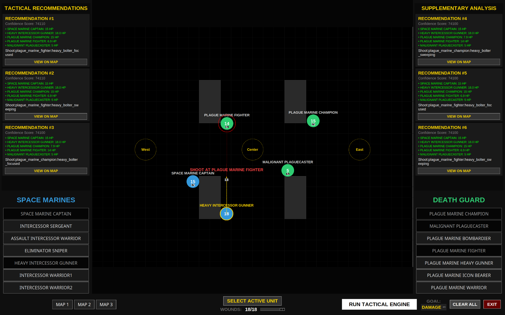

# Warhammer Kill Team Simulátor 

Semestrální práce pro předmět BI-PYT, letní semestr 2026 na FIT ČVUT. Můj projekt se zaměřuje na uživatelsky přívětivé simulace pro hru Warhammer Kill Team. Tato aplikace umožňuje uživatelům simulovat herní situace a získávat doporučení pro optimální tahy.



## Hlavní funkce

- **Vysoce výkonná simulace:** Poháněna enginem s časově omezeným iterativním prohlubováním (Time-Bounded Iterative Deepening).
- **Pokročilé vyhledávání cest:** Využívá knihovnu `shapely` pro geometrické výpočty viditelnosti (Line of Sight) pomocí raycastingu a detekci kolizí.
- **Optimalizace prohledávání:** Implementuje **Beam Search** (ořezávání neoptimálních uzlů) a **Zobrist hashing** (transpoziční tabulky) pro zvládnutí masivního stavového prostoru.
- **Vícekriteriální analýza rozhodování (MCDA):** Dynamicky váží výsledky (způsobené poškození, přežití, postup v plnění úkolů) na základě taktických cílů jako `KILL` (zabít), `CAPTURE` (obsadit) nebo `SURVIVE` (přežít).
- **Integrované GUI:** Komplexní rozhraní v Tkinter pro nastavování scénářů a vizualizaci doporučených sekvencí tahů pomocí dynamických šipek a stavových indikátorů.

## Požadavky

- Python 3.10 nebo vyšší
- Knihovna `tkinter` (obvykle součástí instalace Pythonu, na Linuxu může vyžadovat `sudo apt install python3-tk`)

## Instalace

1. **Klonování repozitáře:**
   ```bash
   git clone <url_repozitáře>
   cd vyhnavik
   ```

2. **Vytvoření a aktivace virtuálního prostředí:**
   - **Linux/macOS:**
     ```bash
     python3 -m venv .venv
     source .venv/bin/activate
     ```
   - **Windows (PowerShell):**
     ```powershell
     python -m venv .venv
     .\.venv\Scripts\Activate.ps1
     ```

3. **Instalace závislostí:**
   ```bash
   pip install -r requirements.txt
   ```

## Použití

### Spuštění GUI
Pro spuštění rozhraní taktického simulátoru se ujistěte, že se nacházíte v kořenovém adresáři projektu (`vyhnavik`), a spusťte aplikaci jako modul:
   - **Linux/macOS:**
     ```bash
     python3 -m app.gui.gui_main
     ```
   - **Windows (PowerShell/CMD):**
     ```powershell
     python -m app.gui.gui_main
     ```

**Jak používat rozhraní:**
1. **Nastavení:** Umístěte operativce na mapu z postranních panelů (Space Marines vs. Death Guard).
2. **Konfigurace:** Kliknutím na jednotku ji nastavte jako **ACTIVE** a pomocí posuvníku upravte její aktuální počet životů (**Wounds**).
3. **Nastavení cíle:** Vyberte svou taktickou prioritu (např. `CAPTURE`) ze spodního menu.
4. **Analýza:** Klikněte na **RUN TACTICAL ENGINE**. Engine bude „přemýšlet“ po dobu max 20 sekund a poté v postranních panelech zobrazí 6 nejlepších doporučených taktických sekvencí.
5. **Vizualizace:** Kliknutím na **VIEW ON MAP** u libovolného doporučení zobrazíte trasu pohybu a plánované akce přímo na bojišti.

## Spouštění testů

Projekt obsahuje komplexní sadu testů pokrývajících datové modely, databázové nástroje a taktické scénáře.

Pro spuštění všech testů se ujistěte, že se nacházíte v kořenovém adresáři projektu, a spusťte testy jako modul:
```bash
python -m pytest
```

## Struktura projektu

- `app/gui/`: Hlavní aplikace v Tkinter a logika uživatelského rozhraní.
- `app/src/`: Jádro logiky, zahrnující:
  - `models.py`: Datové struktury pro operativce a zbraně.
  - `database_utils.py`: Integrace SQLite pro data armád.
  - `simulator/`: Implementace simulačního enginu.
- `tests/`: Sada testů v Pytestu pro logické ověření.

- `notes.ipynb`: Mé poznámky sloužící jako podklad pro prompty a brainstorming.
- `vyhnavik.pdf`: Povinná zpráva o mých nápadech a výsledcích.
- `media/`: Obrázky a PDF s pravidly.

## Uznání
S implementací komplexních vyhledávacích algoritmů a technickou dokumentací pomáhal model Gemini 3.0 na základě mých algoritmických návrhů a taktických poznámek.
